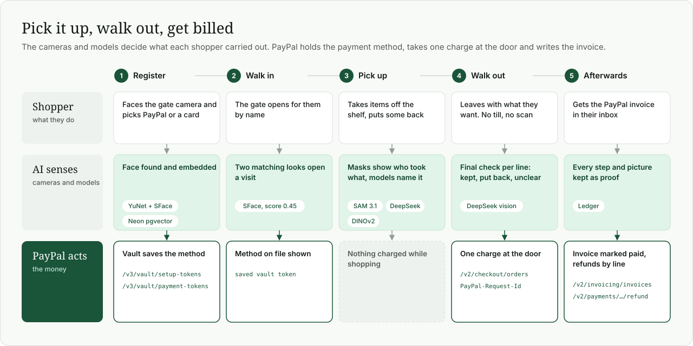
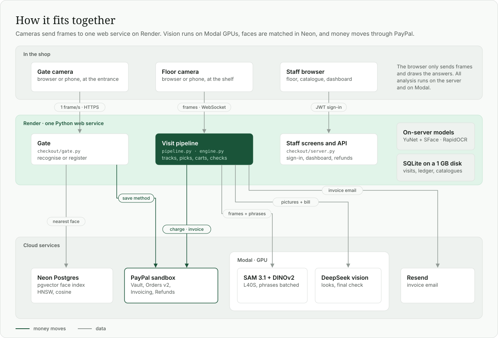
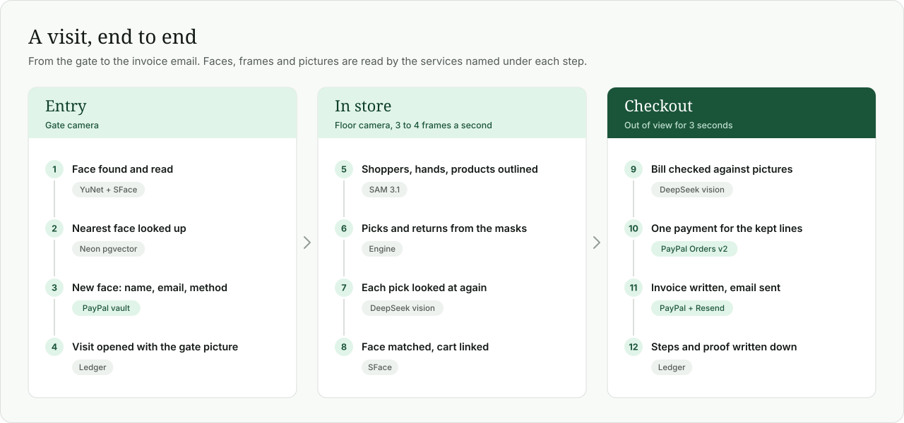
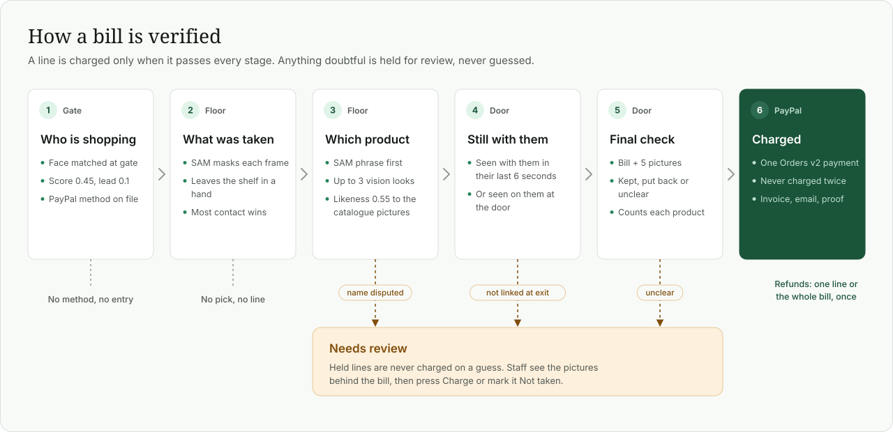
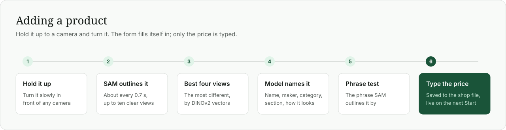
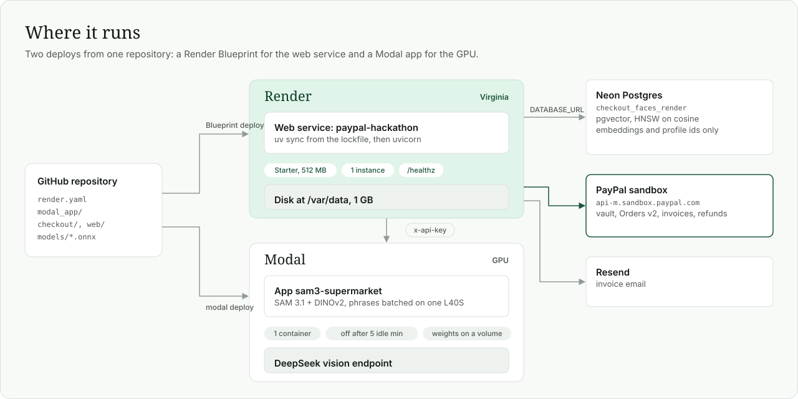
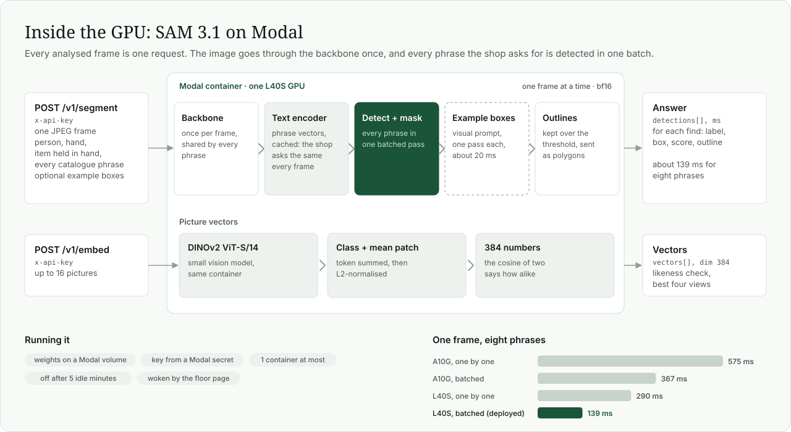

# Carryout: walk-out checkout on SAM 3.1 and PayPal

A cashierless shop that runs on ordinary cameras. Shoppers register once at a gate with their face and a PayPal
payment method, take what they want off the shelf, and walk out. They are charged through PayPal for exactly what
they carried out, and get a PayPal invoice by email.

- **Gate.** A known face with a payment method on file is let in. A new face registers on the spot: name, email and a
  PayPal account or card saved in PayPal's vault. Nobody shops unregistered.
- **Shop floor.** SAM 3.1 outlines every shopper, hand and product in each frame. The shopper whose hand takes an item
  off the shelf gets it on their bill. Put it back and it comes off.
- **Door.** When a shopper leaves, a vision model checks the bill line by line against pictures of them carrying
  things. Only lines it confirms are charged, in one PayPal payment. Anything doubtful is held for staff review.
- **Back office.** Every bill keeps the pictures and steps behind it, so staff can check it, charge a held line, or
  refund through PayPal.



Two shops are included in `shops/`: a supermarket, where each product has its own camera phrase, and a bookshop
(Folio House), where every book is "book" to SAM and the title is read off the cover in the shopper's hands.

Payments run on the **PayPal sandbox**. A Stripe version is kept on the `stripe` branch. Both sit behind the same calls
in `checkout/payments.py`.

## Contents

- [Architecture](#architecture)
- [A visit, end to end](#a-visit-end-to-end)
- [How a bill is verified](#how-a-bill-is-verified)
- [PayPal at the core](#paypal-at-the-core)
- [The AI models and what each one does](#the-ai-models-and-what-each-one-does)
- [How the vision language model is used](#how-the-vision-language-model-is-used)
- [Adding products to the catalogue](#adding-products-to-the-catalogue)
- [Growing the shop](#growing-the-shop)
- [Deployment: Modal, Render and Neon](#deployment-modal-render-and-neon)
- [Data: what is stored where](#data-what-is-stored-where)
- [Run it locally](#run-it-locally)
- [Configuration](#configuration)
- [Results](#results)
- [Tests and rehearsals](#tests-and-rehearsals)
- [Built to expand](#built-to-expand)
- [Files](#files)

## Architecture



The server is one FastAPI process. Heavy vision runs on Modal's GPUs. Face detection, face embeddings and shelf OCR
are small enough to run on the server's CPU. The browser does no analysis: it sends camera frames and draws what the
server sends back.

| Part | Where it runs | What it does |
|---|---|---|
| Web server (`checkout/server.py`) | Render | Screens, the gate API, the floor's WebSocket, staff sign-in |
| Visit pipeline (`checkout/pipeline.py`, `engine.py`) | Render | Frames in order, picks and returns from masks, side jobs for faces, reading and checks |
| SAM 3.1 and DINOv2 (`modal_app/sam_checkout.py`) | Modal, L40S | Outlines people, hands and products. Turns pictures into vectors |
| DeepSeek vision model | Modal | Names picked items, reads book titles, makes the check before charging |
| YuNet + SFace, RapidOCR | Render CPU | Faces at the gate and on the floor. Text on shelves and covers |
| Face index | Neon Postgres + pgvector | "Whose face is this?" in one query, however many shoppers registered |
| Ledger, profiles, catalogues | SQLite and files on Render's disk | Bills, steps, proof pictures, refunds, products |
| Payments | PayPal sandbox | Saved methods, the charge, the invoice, refunds |
| Email | Resend | The invoice email |

## A visit, end to end



## How a bill is verified

Nothing is charged on one signal. A line has to pass every stage below, and anything that fails one is held for review
rather than charged. Staff see the pictures and can charge it by hand or mark it not taken.



### 1. The gate: who is shopping

- Faces are found with OpenCV's YuNet and turned into a 128-number embedding with SFace, on the server, in about
  15 ms. Each profile keeps up to six embeddings from different angles.
- The gate asks the Neon pgvector index for the nearest face (HNSW, cosine distance). A match needs a score of 0.45
  and a lead of 0.1 over the next profile. A face that only resembles someone registers as a new person.
- The same answer has to come twice in a row before the gate acts.
- **No payment method, no profile.** A profile is saved only once PayPal has returned a vault token. A PayPal account
  is approved by the shopper in a PayPal window. A sandbox card is saved the same way.
- The visit opens with the gate picture and the match score, which go on the bill as proof.

### 2. The floor: who took what

Each analysed frame goes to SAM with `person`, `hand`, `item held in hand` and every catalogue phrase. The engine
(`checkout/engine.py`) gives each hand to the shopper whose mask it lies in, and tracks each item as candidate, at
rest or held.

| Decision | Evidence |
|---|---|
| Pick | A resting item leaves its place while a hand is on it, or an item first seen in a hand stays there |
| Inferred pick | A steady shelf item is gone, its spot is in view, and a hand had just closed over it |
| Return | The item sits still with no hand on it, on a shelf or away from the shopper |
| Inferred return | Last seen being put on a shelf, and the shopper's hands have been empty since |
| Hand-over | Only another shopper's hands touch it for over a second |
| Same item again | An item hidden for a moment that reappears in the same hand is not counted twice |

A pick goes to the shopper with the largest share of hand contact over time, not whoever is nearest in one frame.
Thresholds are fractions of the frame diagonal and seconds, so they do not depend on resolution or frame rate.

- **Faces on the floor** are compared only with shoppers the gate let in, and need two matching looks (or one at 0.45)
  before anything goes on their bill. An unknown face is shown as **Not registered** and is never charged.
- **Same shopper, new outline.** If a shopper is lost and reappears with the same face, the two are merged: one
  shopper, one bag, nothing billed twice.
- **A moving camera.** For hand-held footage the engine follows background points and moves every remembered position
  with the camera. Inferred picks are switched off while the camera moves.
- **Far shoppers.** While hands are small in the frame, a second SAM call goes out on a cut-out round them, 2 to 3
  times larger (`checkout/zoom.py`). A tissue pack at arm's length went from not found to 0.45 to 0.59.

### 3. Naming the product

SAM's phrase is the first guess, and phrases spill onto neighbouring items ("wireless power bank" outlined a tissue
pack at 0.36). So:

- A faint outline next to the phrase's own strong one counts for less.
- **Second looks.** The vision model is shown each pick on up to three frames with a box round it, plus the first
  catalogue picture of each candidate. It answers whether the item is held and which product it is.
- **Likeness.** The item is cut out and compared with the catalogue's pictures by DINOv2 vectors. At 0.55 or more, and
  0.05 ahead of the next product, it adds one vote. It never renames an item alone, and never counts as "held".
- The looks can overrule the phrase only with one more signal agreeing. A name the looks dispute is held for review.
- **Books** are all "book" to SAM. The title is read by the vision model in the shopper's hands: two readings put it
  on the bill, three missing readings in a row take it off, and there is one line per title per shopper. A title read
  only on the shelf by OCR never bills anyone.
  Their hands are looked at about once a second, whatever the model's speed (frames wait in a queue), and on every
  frame while something in them cannot be read or a title waits for its second reading. The close-up shown with each
  look is of their outlined hands and what is in them, enlarged, not the whole shopper: a title on a book in a hand
  is a few pixels tall.

### 4. The door: still with them?

A shopper has left when their whole outline has been out of view for `leave_after_s` seconds (set per shop). Leaving
with empty hands does not close the visit. For products without a title:

- the line stays only if the floor saw the item with them in their last 6 seconds in view, or the vision model sees it
  on them in their last six pictures;
- otherwise it is held for review, which is what an item put down out of the camera's view looks like;
- two or more door pictures with both hands empty mark a recent item as put back.

For books, the last six pictures are read again, in order. A title read in them and then missing from the next three
may have been put down on the way out, or be under the others in a stack: the final check decides, and takes it off
only when it sees something going onto a shelf after that. Something in their hands that no picture can read may be
one of the titles not accounted for; the final check works out which.

### 5. The check before charging

The vision model checks the bill in steps, each a separate question about one picture, at most 12 questions a
visit (`Verifier.check_visit`). Every answer may be "unknown", and every step is written to the visit's events and
pictures, so the dashboard shows why each line was charged or not.

1. **Leaving.** What is in their hands in each of the last two views?
2. **Held.** For each line not read as they left: is this item in their hands, in the picture it was last read in?
3. **Shelf.** For each line: in the first few views after that, is something being put on a shelf? If so, a second
   question asks which title it looks like, colour first (the model names its colour, then the title with that
   colour): a title named on a moving book is often a guess. A placing that looks like a book still in their hands
   afterwards is not believed.
4. **Which.** A book in their hands that no view can read: among the titles not accounted for, the ones not seen
   going back, or the one both last views say it looks like. Titles not told apart are held only if something that
   could be one of them was seen going back; otherwise a title read twice on the floor stands.
5. **Cross-check.** Answers that disagree with each other, or with the door look, get one more look at the newest
   view.

| Verdict | Meaning | Charged |
|---|---|---|
| **Kept** | In their hands as they left, or (a product without a title) in hand earlier and not seen put down | Yes |
| **Put back** | Seen put on a shelf, or found gone at the door with something seen going onto a shelf after, and not in hand as they left | No |
| **Unclear** | Not readable as they left | A book whose title was already read twice in their hands, unless something was seen going back that could be it |

No answer from the model means no charge. A product on the bill twice needs two in hand at once.

### 6. Payment and proof

- The kept lines are charged in one PayPal **Orders v2** payment against the saved vault token, shopper not present,
  with a `PayPal-Request-Id` so a retry can never charge twice.
- A PayPal **invoice** is written with the lines and marked as paid. Resend emails it to the shopper.
- The **ledger** keeps every step with its time, the gate picture, the floor face picture, the frame where each item
  left the shelf, and the pictures the final check was shown.
- **Refunds** of one line or the whole bill go through PayPal's capture refund API. The ledger makes sure nothing is
  refunded twice.
- Two runs watching the same shopper charge once: the first run to settle the visit takes it.

## PayPal at the core

The AI decides what a shopper carried out. PayPal is what turns that into a purchase: no till, no card tap, no scan.
Every money step goes through PayPal's REST APIs in the sandbox (`checkout/payments.py`).

| When | PayPal API | What it does |
|---|---|---|
| Registration | `POST /v3/vault/setup-tokens` | Starts saving a PayPal account or a card. A PayPal account is approved by the shopper in a PayPal window |
| Registration | `POST /v3/vault/payment-tokens` | Turns the approved setup token into a saved payment token, `usage_type: MERCHANT` |
| Gate | (saved token) | The method on file is shown when the face is recognised. No method, no entry |
| Walk out | `POST /v2/checkout/orders` | One order with `intent: CAPTURE`, paid from the vault token with the shopper not present. Each line is listed as an item |
| Walk out | `POST /v2/invoicing/invoices` | The invoice for the same lines, then `/send` and `/payments` to mark it paid |
| Dashboard | `POST /v2/payments/captures/{id}/refund` | Gives back one line or the whole bill |

- **Never twice.** Every call carries a `PayPal-Request-Id`. The charge's is made from the session, shopper and visit,
  and a refund's from the visit and line, so a retry is the same request to PayPal, not a second charge.
- **One charge per visit.** However many items, the shopper sees one payment and one invoice.
- **Stored credential rules.** A saved card is charged as `payment_initiator: MERCHANT`, `payment_type: UNSCHEDULED`,
  `usage: SUBSEQUENT`, which is what an unattended checkout is.
- **Sandbox only.** The host is fixed to `api-m.sandbox.paypal.com`, and `PAYPAL_ENV` must say `sandbox`.

## The AI models and what each one does

| Model | Where | Used for |
|---|---|---|
| **SAM 3.1** (Meta) | Modal, L40S | Outlines people, hands and products from text phrases, every frame. Also outlines "more like this box" (visual prompt) on the catalogue screen |
| **DINOv2 ViT-S/14** (Meta) | Modal, same container | Picture vectors for the likeness check and for picking the most different product views |
| **DeepSeek V4.1 Flash** (vision) | Modal, chat completions endpoint | Second looks at picks, titles in the hands, the door look, the check before charging, describing new products |
| **YuNet + SFace** (OpenCV, ONNX) | Server CPU | Face detection and 128-number face embeddings |
| **RapidOCR** | Server CPU | Reading book spines on the shelf, about 100 ms each |

Two kinds of model check each other. SAM decides *that* something was taken, from geometry. The vision model decides
*what* it was and *whether it is still with the shopper*, from looking. A charge needs both to agree.

## How the vision language model is used

The vision language model (DeepSeek V4.1 Flash on Modal, `checkout/verify.py`) never watches the video. It is asked
short, specific questions about a few pictures, each with a yellow box drawn round what it should look at, and must
answer in JSON at temperature 0. It runs beside the frame loop, so the floor never waits for it.

| Question | When | Shown | Answers |
|---|---|---|---|
| **Second look** | Each pick, on up to three frames | The frame with the item boxed, catalogue pictures, any text OCR read | Is it held, and which product |
| **Titles in the hands** | About once a second while a shopper carries books | The frame with the shopper boxed | Which titles they hold, and how many they cannot read |
| **Still carrying?** | At the door | The shopper's last six pictures, catalogue pictures | Which products are still on them, how many hands are visible |
| **Shelf reading** | When OCR cannot name a spine | The spine boxed | Which catalogue title it is |
| **Check before charging** | Once per walk-out | The bill and up to five lettered pictures | Per line: kept, put back or unclear, with the picture it saw |
| **Describe a product** | On the catalogue screen | The object boxed | Name, maker, category, section, look, and phrases to try |

The answers are only ever votes. A line is charged when the masks, the looks and the final check agree, and a missing
or malformed answer counts as "not confirmed", never as "yes".

## Adding products to the catalogue

The **Catalogue** screen (`/catalogue`) is where products are added, without editing files.



**Hold to camera.** Hold the product up and turn it slowly. The form comes back filled in with the name, maker,
category and section, what it looks like, the phrase that outlined it best, and four pictures. Only the price is left
to type.

**From a clip.** Import a video or pick a sample. It is cut into up to 120 frames, and SAM outlines what it finds on
each. Click an outline, or drag a box round something it missed, then:

- *Describe it*: the vision model names the object as sold, with its packaging (two rolls wrapped together are a pack
  of two), and suggests phrases.
- *Test the phrases*: each phrase is run on that frame and two either side. A phrase counts when its outline covers
  the picked object (overlap 0.6 or more). On the freezer sample, only "packaged food" out of four phrases outlined
  the pack in hand.
- *Find more like it*: SAM's visual prompt with the picked box as the example.
- *Add as a new product*, or add the picture to an existing one.

Each product row has up to four pictures, name, maker, category, section, camera phrase and price. The same screen
lists the shopper's own things that are never billed (phones, wallets) and the seconds out of view that count as
leaving. Changes apply on the next Start.

A product in `shops/<shop>.json` looks like this:

```json
{
  "id": "pmwawnx7s",
  "name": "Wireless Earbuds Charging Case",
  "prompt": "charging case",
  "price": 299.0,
  "cues": "small white rounded rectangular case, grey label, glossy plastic",
  "category": "Electronics",
  "section": "Mobile Accessories",
  "examples": ["ex-7c05d01ea4dd4be4.jpg", "ex-71cba51dd5964153.jpg"]
}
```

## Growing the shop

The shop is meant to start small and grow: a short list of products that are told apart reliably, then more, checked
on the floor as they are added.

- **More products.** Every phrase is part of the same SAM request. Phrases are batched on the GPU (eight phrases in
  139 ms on an L40S). Beyond `SAM_MAX_PROMPTS` phrases (16 on this app's endpoint) the client splits them into
  parallel requests.
- **Products that look alike to SAM** share one phrase and are told apart another way, as the bookshop does with
  27 titles under "book": by reading text, by the vision model, and by likeness to the catalogue pictures.
- **More shoppers.** The gate's face lookup is one pgvector nearest-neighbour query on Neon, so it stays one query
  however many people register. The floor only compares faces with shoppers currently inside.
- **More shops.** Each shop is one JSON file and a folder of pictures. The floor picks the shop at Start.
- **More GPU.** The Modal app runs one container (`max_containers=1`), which keeps up with about seven frames a second.
  Raising that number adds capacity for more cameras, at the cost of more GPU time.
- **Next steps for a real store:** a camera at the door instead of "out of this camera's view", several floor cameras
  per shop, and more than one server instance (gate tickets and live visits are in process memory today).

## Deployment: Modal, Render and Neon



### Modal: SAM 3.1 on a GPU



`modal_app/sam_checkout.py` is this app's own SAM 3.1 deployment. It runs every phrase of a frame through the
detector as one batch, reusing the image backbone, and caches phrase embeddings because a shop asks for the same
phrases on every frame. The same container also runs DINOv2 for picture vectors. One frame with eight phrases:

| GPU | One phrase at a time | Batched |
|---|---|---|
| A10G | 575 ms | 367 ms |
| L40S (deployed) | 290 ms | 139 ms |

```bash
modal deploy modal_app/sam_checkout.py              # https://<workspace>--sam3-supermarket.<region>.modal.run
BENCH_GPU=L40S modal run modal_app/sam_checkout.py  # the timing above, on a GPU of your choice
```

| Endpoint | Body | Answer |
|---|---|---|
| `GET /health` | | Model, GPU, features. No key |
| `POST /v1/segment` | `image_base64`, up to 16 `prompts`, `threshold`, optional `exemplars` | Detections with label, box, score, polygons |
| `POST /v1/embed` | up to 16 `images_base64` | 384-number DINOv2 vectors, L2-normalised |

- The weights are read from the Modal volume `deck-twin-sam31`. The API key comes from the Modal secret
  `sam3-supermarket`, sent as `x-api-key`.
- One L40S container at most. It switches off five minutes after the last frame and takes up to a minute to start.
  The shop floor page wakes it when it opens and keeps it awake while in use, so Start is immediate in a demo.
- Live, the app analyses 3 to 4 frames a second with answers about 0.4 s behind.
- The DeepSeek vision model is a separate Modal endpoint, called with `Modal-Key` and `Modal-Secret` headers.

### Render: the web service

The repository is a Render Blueprint (`render.yaml`): one Python web service, `uv sync --frozen` from the lockfile,
Python 3.11, a 1 GB disk at `/var/data`, and health checks on `/healthz` (which, unlike `/api/health`, never wakes the
GPU). It runs in Virginia, next to the Modal endpoints.

1. In Render, **New → Blueprint**, and pick this repository.
2. Fill in what it asks for: `STAFF_CODE` (at least 8 characters) and the keys from `.env` (`SAM_*`, `LLM_*`,
   `PAYPAL_CLIENT_*`, `RESEND_*`, `DATABASE_URL`). `JWT_SECRET` is generated. `PAYPAL_ENV` is fixed to `sandbox`.
3. Deploy. Shoppers use `https://<service>.onrender.com/gate`. Staff open the same address and sign in.

- **Its own data.** The database, catalogues and clips live on the disk (`DATA_DIR`). On first start the catalogues
  are copied from `shops/`. After that the disk's copy is the one the catalogue screen edits.
- **One instance.** Gate tickets, live visits and the sign-in throttle are kept in process memory.
- **Memory.** Under a 512 MB cap, seven sample visits in a row levelled off at about 375 MB. A finished visit keeps
  only the pictures its bill was checked against, settled shoppers' frames are dropped, and `MALLOC_ARENA_MAX=2` stops
  each thread keeping its own memory pool. Only headless OpenCV is installed.
- **The face models** (`models/*.onnx`, 37 MB) are in the repository, so the build needs nothing else.
- **Why Starter.** The disk needs a paid plan. The free plan has no disk and sleeps, which would wipe the database.

### Neon: the face index

With `DATABASE_URL` set, face embeddings are stored in Neon Postgres with pgvector (`checkout/vectors.py`): one table,
an HNSW index on cosine distance, and one query to find the nearest face:

```sql
SELECT profile, 1 - (embedding <=> $face) AS score
FROM checkout_faces ORDER BY embedding <=> $face LIMIT n;
```

- **Only embeddings and profile ids** go to Neon. Pictures, names, emails and payment links stay in SQLite on the
  server.
- **One table per copy.** `FACE_TABLE` gives the Render copy its own table (`checkout_faces_render`), because each copy
  keeps the table in step with its own database.
- The floor matches against an in-memory copy of the embeddings, so it never waits on the network.
- Without `DATABASE_URL`, faces are matched on the server and everything else still works.

### Staff sign-in

The gate (`/gate`, its API, the PayPal return page) is public. Everything else is private: the floor, the catalogue,
the dashboard, their APIs and the floor's WebSocket. The guard in `checkout/server.py` is deny-by-default, and a test
walks every route to keep it that way.

- Staff enter the **staff code** once at `/signin`. The server returns a JWT (HS256, `JWT_SECRET`, 12 hours) as an
  HttpOnly cookie, and also in the reply for scripts (`Authorization: Bearer …`).
- Each token is recorded by id with a salted SHA-256 hash, never the token itself. **Sign out** revokes it.
- Wrong codes are capped: five from one address in ten minutes, and 30 from all addresses together, so guessing
  from many made-up addresses gets nowhere.
- On a local computer without `STAFF_CODE`, the staff screens are open to that computer only. A hosted copy refuses to
  start without both values.

## Data: what is stored where

| Store | Holds |
|---|---|
| **SQLite** `checkout.db` on the server's disk | `profiles`, `faces` (pictures and embeddings), `visits`, `admissions`, `purchases`, `proofs` (pictures), `refunds`, `staff_tokens` |
| **Neon Postgres + pgvector** | Face embeddings and profile ids only, for the gate's nearest-face search |
| **Files on the disk** | Catalogues (`shops/*.json`), product pictures, clips and SAM's cached answers |
| **PayPal** | Saved payment methods (vault tokens), orders, captures, invoices, refunds |
| **Modal volume** | SAM 3.1 weights |

Faces are biometric data. Pictures never leave the server. "Delete all shoppers" removes profiles from SQLite and
their embeddings from Neon. Anyone filmed for real must agree to it first.

## Run it locally

```bash
cp .env.example .env    # then fill in the keys
uv run uvicorn checkout.server:app --port 8765
```

| Screen | Address | For |
|---|---|---|
| Gate | http://localhost:8765/gate | Shoppers: be recognised or register, then walk in |
| Shop floor | http://localhost:8765 | Staff: the camera, each shopper's bag, what happened at the door |
| Catalogue | http://localhost:8765/catalogue | Staff: products, pictures, adding new ones from a camera or clip |
| Dashboard | http://localhost:8765/dashboard | Staff: sales, transactions with proof, customers, refunds |

On the shop floor, pick a shop and the footage (a camera, a sample clip or a video file), then press Start.
**Rehearsal** runs everything except the charge, the invoice and the email.

Each item a shopper holds carries a label with its name in the shopper's colour, with a tick once it is sure enough
to bill. "Live camera" lists every camera the computer can see, and the gate has its own list, so the two stations
can use different cameras.

**From a phone.** A phone browser only shares its camera on an https page: use the Render address, or a tunnel to the
local server (`ngrok http 8765`).

## Configuration

Keys live in `.env`, which git ignores. `.env.example` lists them.

| Variable | For |
|---|---|
| `SAM_URL`, `SAM_API_KEY` | The SAM 3.1 endpoint on Modal |
| `SAM_MAX_PROMPTS`, `SAM_MAX_FPS` | What that endpoint takes: phrases per request, frames per second |
| `LLM_URL`, `LLM_MODAL_KEY`, `LLM_MODAL_SECRET` | The DeepSeek vision model on Modal |
| `PAYPAL_CLIENT_ID`, `PAYPAL_CLIENT_SECRET`, `PAYPAL_ENV` | PayPal. `PAYPAL_ENV` must be `sandbox`, or payments stay off. Only `api-m.sandbox.paypal.com` is ever called |
| `DATABASE_URL` | Neon Postgres with pgvector, for the face index |
| `FACE_TABLE` | This copy's own face table |
| `RESEND_API_KEY`, `RESEND_FROM` | Invoice emails |
| `STAFF_CODE`, `JWT_SECRET` | Staff sign-in |
| `DATA_DIR` | Where the database, catalogues and clips live |
| `DEMO_EMAIL` | Prefilled in the registration form on a local computer, never on the public gate |

PayPal, Neon and email are each optional. Without one, that part switches off and the screens say so.

## Results

| What | Result |
|---|---|
| **End to end on real footage** | Hand-held phone clip, three books picked up and one put back (the original phone file; `samples/bookshop-demo.mp4` is the same clip re-encoded for browsers). On 12 November 2026, 8 of 8 live runs of the original file billed the right two books, USD 154.00. Runs of the re-encoded copy have missed Ikigai so far, which is still open |
| **A real sandbox payment** | USD 154.00 charged to a saved sandbox card for that clip, PayPal invoice 0016 written and marked paid, invoice email sent |
| **SAM 3.1 per frame** | 139 ms for eight phrases on an L40S, batched, against 290 ms one phrase at a time |
| **Live speed** | 3 to 4 analysed frames a second, answers about 0.4 s behind the camera |
| **Faces** | Found and embedded in about 15 ms on the server's CPU. Nearest-face search in Neon in about 110 ms |
| **Far-off items** | The closer look round small hands took a tissue pack at arm's length from not found to scores of 0.45 to 0.59 |
| **Likeness** | A pack in a shopper's hand scored 0.71 against its own catalogue picture, enough to name it |
| **Several shoppers** | Five shoppers at once in the crowd test: each charged once, only for what they carried out |
| **Memory on Render** | Seven sample visits in a row levelled off at about 375 MB inside a 512 MB plan |
| **Tests** | 135 passing |

## Tests and rehearsals

```bash
uv run pytest
```

| Test | Covers |
|---|---|
| `test_engine.py` | Pick logic on synthetic masks: two shoppers at one shelf, put-backs, hand-overs, re-entry |
| `test_crowd.py` | Five shoppers at once: only what was carried out is charged, once |
| `test_books.py` | A title is billed only once read in the hands, never twice |
| `test_gate.py` | Known face let in, new face registered with a card or PayPal account, the vector index, open visits only |
| `test_paypal.py` | The PayPal provider against a stand-in API: sandbox only, a refund goes back once |
| `test_last_check.py` | The check before charging, in steps |
| `test_left_behind.py` | Items no longer linked to the shopper at the door are held, not charged |
| `test_zoom.py` | The closer look round far hands |
| `test_staff.py` | Staff sign-in, and every route checked so only the gate is public |
| `test_catalogue.py` | Pictures, clips, phrase ranking, the most different views, the likeness check |
| `test_ledger.py` | Steps and pictures kept, rehearsals apart from sales, refunds and manual charges at most once |

Play a clip to the running server as if it were a camera:

```bash
uv run tools/live_client.py samples/bookshop-demo.mp4 --shop bookshop --width 1600 --dry   # rehearsal: no charge, no email
uv run tools/live_client.py samples/bookshop-demo.mp4 --shop bookshop --width 1600         # real: charges the registered shopper
uv run python -m checkout.cli samples/49350-720.mp4 --fps 3 --verify                  # offline, annotated video in out/
```

Rehearse before any real run. Only a shopper the gate has let in is charged, so register at the gate first.

## Built to expand

The system is built to grow from a single shelf to a whole store. It already tracks several shoppers at once, each
with their own cart, from the moment the gate lets them in until they walk out: what each person picks up goes on
their cart, what they put back comes off, and each is charged only for what they carry out. More cameras, more
products and more shops plug into the same pipeline.

## Files

| Path | What |
|---|---|
| `checkout/server.py` | Web server, WebSocket, staff guard |
| `checkout/pipeline.py` | One visit: frames in order, plus the side jobs beside them |
| `checkout/engine.py` | Masks to picks, returns and bags |
| `checkout/people.py` | Shopper tracking and re-identification by clothing |
| `checkout/gate.py` | The gate: recognise or register, then open a visit |
| `checkout/identity.py` | Profiles, faces, admissions and visits in SQLite |
| `checkout/vectors.py` | Face embeddings in Neon with pgvector |
| `checkout/verify.py` | The vision model: second looks, titles, the check before charging |
| `checkout/likeness.py` | How alike a picked item looks to a product's pictures |
| `checkout/zoom.py` | The closer look round far hands |
| `checkout/reader.py` | Local OCR and matching text to titles |
| `checkout/sam_client.py` | Client for the SAM endpoint |
| `checkout/payments.py` | PayPal sandbox: vault, charge, invoice, refund |
| `checkout/ledger.py` | Every walk-out with its steps, pictures and refunds |
| `checkout/mailer.py` | The invoice email through Resend |
| `checkout/staff.py` | Staff sign-in |
| `checkout/clips.py` | Catalogue footage: clips, camera captures, phrase ranking |
| `checkout/catalog.py` | Loading and saving a shop's catalogue |
| `checkout/cli.py` | Run a video offline and write an annotated copy |
| `modal_app/sam_checkout.py` | The batched SAM 3.1 + DINOv2 endpoint on Modal |
| `shops/` | One catalogue per shop, with its pictures |
| `web/` | The screens: gate, shop floor, catalogue, dashboard, shared header and styles |
| `tools/live_client.py` | Play a clip to the running server in real time |
| `tools/draw_diagrams.py` | Draws the diagrams in `docs/diagrams/` |
| `models/` | The two OpenCV face models |
| `render.yaml` | The Render Blueprint |

## Licence

The code is under the GNU Affero General Public License v3.0 (`LICENSE`). The face models in `models/` come from the
OpenCV model zoo and keep their own licences: YuNet (MIT) and SFace (Apache 2.0).
